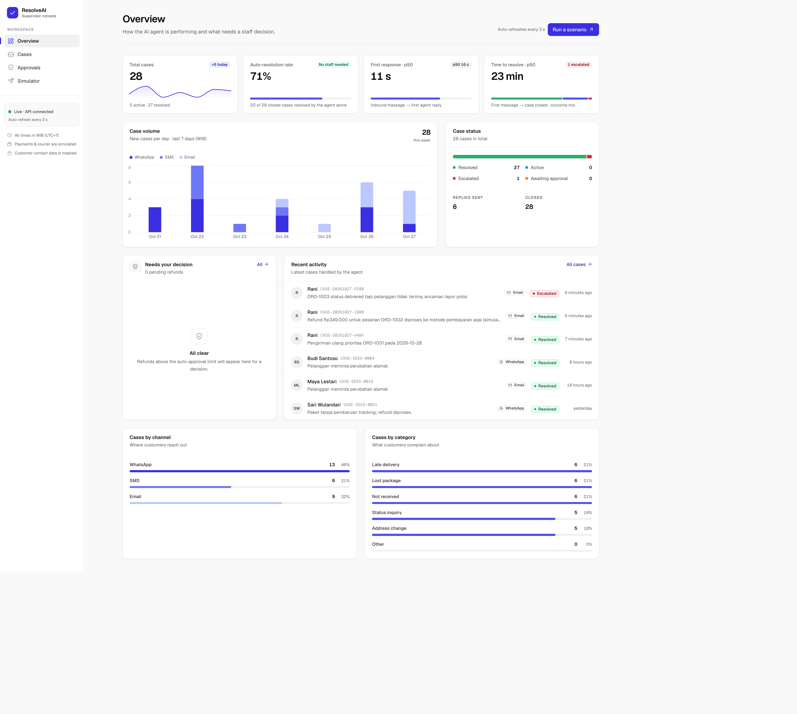
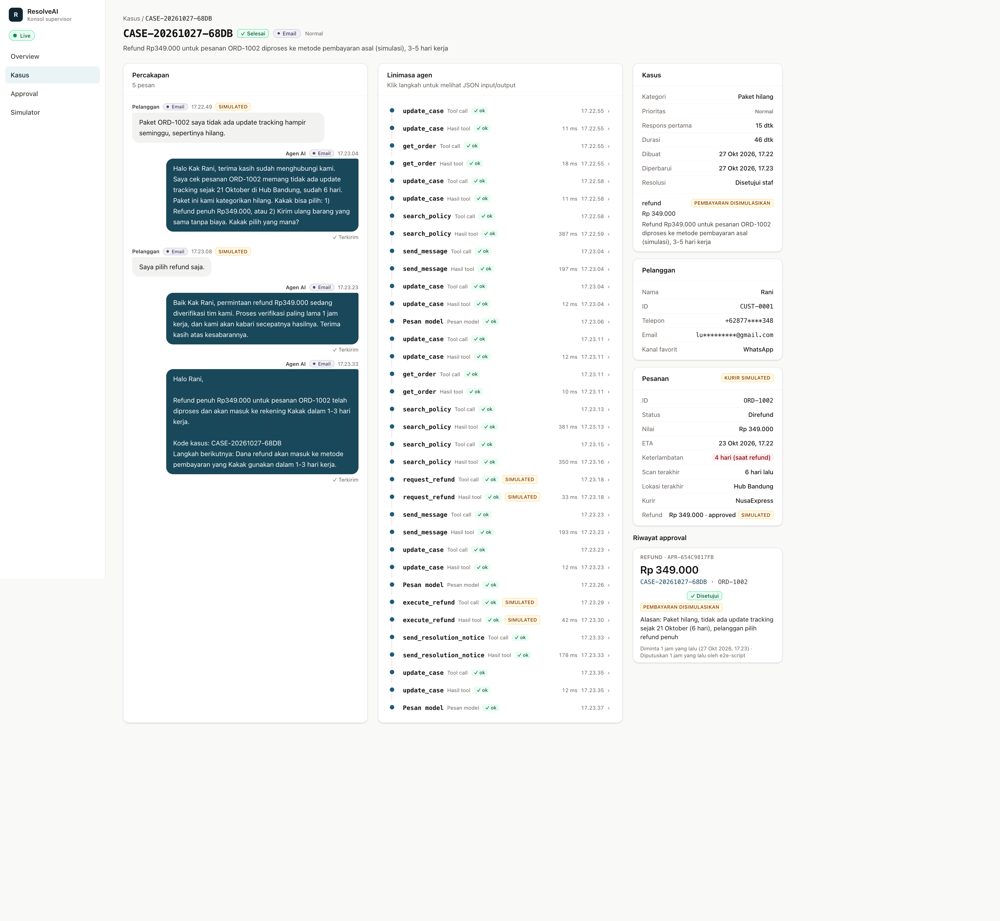
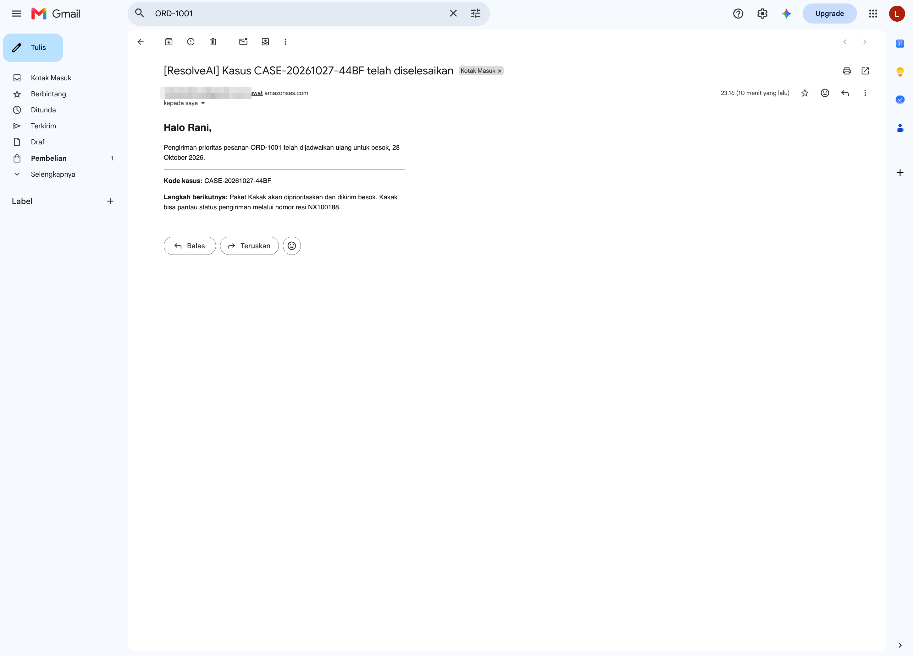

<p align="center">
  <picture>
    <source media="(prefers-color-scheme: dark)" srcset="docs/brand/logo-full-dark.svg">
    
  </picture>
</p>

# ResolveAI

**An agentic customer-recovery agent on AWS that resolves delivery complaints end to end over WhatsApp, SMS, and email, and brings in a human only for risky decisions.**

Built for the *AWS CDS Agentic AI Hackathon (Sept. 2026)*. License: [MIT](LICENSE).

> **Project status (honest):** deployed and verified on AWS in `us-east-1`. All 5 CDK stacks (`resolveai-dev-{data,messaging,knowledge,web,compute}`) are in `CREATE/UPDATE_COMPLETE`. The Strands agent runs on **Amazon Bedrock AgentCore Runtime** with `us.anthropic.claude-sonnet-4-5-20250929-v1:0` (inference profile). Scenarios A, B (approve and reject) and C were run end to end on 27 Oct 2026 with **real email replies via Amazon SES**. WhatsApp inbound is verified; WhatsApp outbound is blocked by Meta (see below). Payments and courier are **simulated**. See [`docs/STATUS.md`](docs/STATUS.md).

| Channel | Status |
|---|---|
| **Email (Amazon SES)** | **Verified.** Real replies delivered via SES (sandbox, verified identity). Inbound is injected via `POST /api/simulate/inbound` and labelled "SIMULATED INBOUND" in the dashboard. |
| **WhatsApp (End User Messaging Social)** | **Inbound verified; outbound blocked pending Meta business verification.** WABA and number registered; real inbound SNS events are received and parsed; delivery-status webhooks (sent/delivered/read/failed) are tracked in the dashboard. Outbound sends fail with Meta error `131031 Business Account locked`. |
| **SMS (End User Messaging SMS)** | **Not verified.** Adapter implemented; no origination identity configured. |

## Live demo

- **Dashboard:** https://dhv2ziygcntil.cloudfront.net (static Next.js on S3 + CloudFront with OAC; a CloudFront Function handles deep links).
- **API:** `https://3sr2wztr8f.execute-api.us-east-1.amazonaws.com/api` (requires `x-api-key`; `/api/health` is public). The demo API key is embedded in the dashboard bundle (demo only, see Limitations).
- Try it: open **Simulator** in the dashboard, send a preset complaint, then watch the case, agent timeline and approvals.

## Evidence

| What | File |
|---|---|
| Scenario A (late delivery, redelivery) `CASE-20261027-44BF` → resolved | [`scenario-a-case.json`](docs/evidence/scenario-a-case.json), [`scenario-a-email.png`](docs/evidence/scenario-a-email.png) |
| Scenario B approve (refund Rp349,000 simulated after staff approval) `CASE-20261027-1BB8` → resolved | [`scenario-b-approve-case.json`](docs/evidence/scenario-b-approve-case.json), [`scenario-b-email.png`](docs/evidence/scenario-b-email.png) |
| Scenario B reject `CASE-20261027-5DAF` → escalated, no `execute_refund` | [`scenario-b-reject-case.json`](docs/evidence/scenario-b-reject-case.json) |
| Scenario C (delivered-not-received + police threat) `CASE-20261027-FE0B` → escalated high | [`scenario-c-case.json`](docs/evidence/scenario-c-case.json), [`scenario-c-email.png`](docs/evidence/scenario-c-email.png) |
| RAG retrieval eval: hit@4 15/16 = 93.8% | [`eval_rag.md`](docs/evidence/eval_rag.md) |
| Dashboard screenshots | [`docs/evidence/screenshots/`](docs/evidence/screenshots/) (`01-overview.png` … `07-simulator.png`) |

Gmail inbox screenshots have the recipient address blurred.





## Submission

| Item | Value |
|---|---|
| Repository | https://github.com/Akar-Samudra-Artifisial/AWS-Agentik-AI |
| License | [MIT](LICENSE) |
| Architecture diagram | [`docs/architecture.md`](docs/architecture.md) |
| Demo video | https://www.youtube.com/watch?v=GprVqlJucqU (2:55, English narration) |
| Live solution | https://dhv2ziygcntil.cloudfront.net |
| ACE Opportunity ID | `TBD` |

---

## Problem

E-commerce and logistics support teams spend most of their time on repetitive tickets: "where is my order?", late deliveries, lost parcels. Chatbots can answer these, but they can't *fix* anything. The customer still waits for a human to issue a voucher, rebook a delivery, or approve a refund.

## Solution

ResolveAI is an AI agent that **takes real actions** inside guardrails written in code:

- It reads the order (status, ETA, last tracking scan) and the store's policies (RAG over a Bedrock Knowledge Base).
- It offers the options the policy allows, then executes the one the customer picks.
- It messages the customer back on their channel (WhatsApp first, falling back to SMS, then email) through the real AWS SDK.
- Refunds above a threshold need a **human approval** in the supervisor dashboard before they run.
- Anything outside policy (legal threats, "delivered but not received" claims) gets **escalated** to staff.

### Agentic capabilities

| Capability | Tool(s) | Guardrail (enforced in code) |
|---|---|---|
| Look up orders | `get_order`, `find_orders_by_customer` | Order must belong to the case's customer |
| Policy-grounded answers (RAG) | `search_policy` | Bedrock KB retrieval; static fallback over `rag/policies/` when no KB is configured |
| Delay compensation voucher | `create_voucher` | Capped at `VOUCHER_MAX_IDR` (Rp25,000), only when delay ≥ 2 days |
| Priority redelivery | `schedule_redelivery` | Only for shipped / in-transit / out-for-delivery orders |
| Refund with human-in-the-loop | `request_refund`, `execute_refund` | Amounts above `AUTO_REFUND_LIMIT_IDR` (Rp100,000) create a `pending` approval; `execute_refund` runs only if a DynamoDB approval with status `approved` matches case + order + amount |
| Escalation | `escalate_to_human` | Priority `high` for legal threats; staff-hours aware (08:00–20:00 WIB) |
| Case lifecycle | `update_case` | Only valid status transitions are allowed |
| Customer messaging | `send_message`, `send_resolution_notice` | No recipient parameter: recipient is derived from the case; per-turn outbound limit; no internal IDs in message bodies |

Policy constants live in one place: [`packages/common/src/resolveai_common/policy.py`](packages/common/src/resolveai_common/policy.py).

## AWS services

| Service | Role in ResolveAI |
|---|---|
| **AWS End User Messaging Social** (WhatsApp) | Inbound customer messages (via SNS event destination) and outbound replies |
| **AWS End User Messaging SMS** | Fallback outbound channel |
| **Amazon SES** | Email notifications (resolution / refund confirmations) |
| **Amazon Bedrock** | LLM for the agent; Titan Text Embeddings V2 for the KB |
| **Amazon Bedrock AgentCore Runtime** | Hosts the Strands agent (`agent/app.py`); a Lambda fallback with the same code exists (`agent/lambda_handler.py`) |
| **Amazon Bedrock Knowledge Bases** | RAG over the store policies in `rag/policies/` |
| **AWS Lambda** | `dispatcher` (inbound orchestration) and `api` (FastAPI + Mangum) |
| **Amazon API Gateway** (HTTP API) | Dashboard backend, protected by an `x-api-key` header |
| **Amazon DynamoDB** | Customers, orders, cases, messages, agent events, approvals, idempotency |
| **Amazon SNS** | Inbound WhatsApp event topic |
| **Amazon S3 + Amazon CloudFront** | Static dashboard hosting (private bucket, Origin Access Control); KB documents bucket |
| **AWS Systems Manager Parameter Store** | Runtime configuration under `/resolveai/dev/...` |
| **AWS CDK (Python)** | Infrastructure as code (`infra/`) |

## Architecture

See **[docs/architecture.md](docs/architecture.md)** for the flowcharts (inbound path, dashboard/approval path), the Scenario B sequence diagram, and a component-to-file map.

In short: WhatsApp → End User Messaging Social → SNS → Lambda `dispatcher` (dedupe, case lookup, lock) → AgentCore Runtime (Strands agent + tools) → DynamoDB / Knowledge Base / SES / SMS / WhatsApp. The supervisor dashboard (S3 + CloudFront) calls API Gateway → Lambda `api`; approving a refund re-invokes the agent asynchronously.

## How WhatsApp is used

WhatsApp is the primary two-way channel. Customers complain in free text on WhatsApp; End User Messaging Social publishes the event to SNS, which triggers the dispatcher and the agent. The agent replies on WhatsApp with options, the customer answers ("1", "refund", …), and the final confirmation goes out on WhatsApp plus email. If WhatsApp delivery fails, the messaging layer falls back to SMS, then email (`packages/common/src/resolveai_common/messaging/dispatch.py`). The dashboard **Simulator** can inject the same inbound event without a phone.

**Current state:** the WABA and phone number are registered, and real inbound WhatsApp events arrive through SNS and are parsed by the dispatcher (captured fixtures: `tests/fixtures/whatsapp_*.json`). Delivery-status webhooks (sent/delivered/read/failed) are tracked and shown in the dashboard. **Outbound WhatsApp is blocked**: Meta returns error `131031 Business Account locked` because Meta Business Verification of the portfolio is still pending. The verified demo therefore uses email (SES) for replies.

## Repository layout

```
.
├─ agent/                 # Strands agent: app.py (AgentCore entrypoint), lambda_handler.py (fallback),
│                         #   runner.py, guards.py, tools/ (11 tools), prompts/system_id.md
├─ backend/
│  ├─ api/                # FastAPI + Mangum: cases, approvals, metrics, simulate inbound
│  ├─ dispatcher/         # SNS/async inbound → dedupe → case → invoke agent (fail-safe)
│  └─ services/           # shared backend services (config, data, AgentCore client)
├─ packages/common/       # resolveai_common: models, DynamoDB repository, policy, phone,
│                         #   logging, messaging adapters (SES / SMS / WhatsApp + fallback), templates
├─ rag/                   # policies/*.md (7 policy docs) + eval/queries.yaml
├─ infra/                 # AWS CDK app: data, messaging, knowledge, web, compute stacks
├─ dashboard/             # Next.js (App Router, static export) supervisor console
├─ scripts/               # seed.py, send_test_message.py, build_lambda.sh, build_agent.sh, dump_openapi.py
├─ tests/                 # pytest suite (offline: moto, Stubber, fake model)
├─ docs/                  # PRDs, STATUS.md, architecture.md, evidence/
└─ Makefile
```

## Prerequisites

- An AWS account with permissions for the services above, in **`us-east-1`**.
- AWS CLI v2 configured (e.g. `aws configure sso`).
- Python 3.12 (Lambda runtime target), Node.js 20+ and npm (dashboard and CDK CLI via `npx`).
- The AgentCore starter toolkit CLI (`agentcore`) for deploying the agent.
- A Meta Business account and a dedicated phone number for the WhatsApp Business Account (WABA).

## Setup and deployment

### 1. Local install and tests

```bash
make install          # .venv + packages/common[dev]
make test             # pytest -q tests
make lint             # ruff
make infra-install    # infra/.venv with CDK dependencies
make synth            # build Lambda bundle + cdk synth
```

### 2. Manual AWS steps (not automated by CDK)

These involve third-party approval, so start them early.

1. **Bedrock model access:** enable the agent LLM and **Titan Text Embeddings V2** in the Bedrock console (`us-east-1`).
2. **SES:** verify the sender identity and, while in the SES sandbox, the demo recipient email.
3. **WhatsApp:** register a WABA through End User Messaging Social, add the phone number, and set its event destination to the SNS topic `inbound-whatsapp` created by the messaging stack (output `inbound-topic-arn`).
4. **SMS:** create an origination identity and verify the destination number in the SMS sandbox.
5. **Knowledge Base:** create it in the console with an S3 data source pointing at the KB docs bucket (data stack output), using Titan Text Embeddings V2. The KB is not created by CDK (see `docs/STATUS.md` → decisions).
6. **SSM parameters** under `/resolveai/dev/`:

   | Parameter | Content |
   |---|---|
   | `bedrock/model_id` | LLM model ID / inference profile ID |
   | `kb/id` | Knowledge Base ID |
   | `wa/phone_number_id` | End User Messaging Social phone number ID |
   | `wa/meta_api_version` | e.g. `v20.0` |
   | `sms/origination_identity` | SMS origination number / sender ID / pool |
   | `ses/from_email` | Verified sender email |
   | `agent/runtime_arn` | AgentCore Runtime ARN (after step 4 below) |
   | `api/key` | Shared demo API key (**SecureString**) |
   | `demo/phone_e164`, `demo/email` | Developer's own demo contact |

   ```bash
   aws ssm put-parameter --name /resolveai/dev/api/key --type SecureString --value "<random-key>"
   ```

### 3. Deploy infrastructure and seed data

```bash
make bootstrap        # cdk bootstrap (once per account/region)
make deploy           # build Lambda bundle + cdk deploy --all
DEMO_PHONE_E164=<your E.164 number> DEMO_EMAIL=<your email> make seed
```

CDK outputs include the API URL (`api-url`), the dashboard URL (`web-url`), the web bucket name (`web-bucket-name`), and the CloudFront distribution ID (`web-distribution-id`).

### 4. Deploy the agent to AgentCore Runtime

```bash
make build-agent      # vendors resolveai_common + policy docs into agent/_vendor/
cd agent
agentcore configure   # entrypoint: app.py
agentcore launch
```

Store the resulting runtime ARN in SSM as `/resolveai/dev/agent/runtime_arn`. The agent reads `bedrock/model_id` and `kb/id` from env or SSM, but the messaging adapters read their origination identities from **environment variables** (`SES_FROM_EMAIL`, `SMS_ORIGINATION_IDENTITY`, `WA_PHONE_NUMBER_ID`, optional `WA_META_API_VERSION`), so set those on the runtime. If AgentCore deployment is blocked, the same code can run as a Lambda with handler `agent.lambda_handler.handler`.

### 5. Ingest and evaluate the Knowledge Base

```bash
.venv/bin/python scripts/ingest_kb.py   # upload rag/policies to S3 + start ingestion job
.venv/bin/python scripts/eval_rag.py    # retrieval hit@k over rag/eval/queries.yaml
```

### 6. Build and publish the dashboard

```bash
cd dashboard
cp .env.example .env.local    # fill in the NEXT_PUBLIC_* values below
npm install
npm run build                 # static export in dashboard/out/
aws s3 sync out/ s3://<web-bucket-name> --delete
aws cloudfront create-invalidation --distribution-id <web-distribution-id> --paths "/*"
```

For local development: `make dashboard-dev` (http://localhost:3000).

### Environment variables

| Variable | Where | Purpose |
|---|---|---|
| `DEMO_PHONE_E164` | `scripts/seed.py` | Demo customer phone (the developer's own number, E.164) |
| `DEMO_EMAIL` | `scripts/seed.py` | Demo customer email (the developer's own address) |
| `NEXT_PUBLIC_API_BASE_URL` | dashboard build | API Gateway base URL including `/api`, no trailing slash |
| `NEXT_PUBLIC_API_KEY` | dashboard build | Shared demo API key (see Limitations) |
| `NEXT_PUBLIC_DEMO_PHONE_E164` | dashboard build | Demo phone used by the Simulator presets (optional) |
| `BEDROCK_MODEL_ID`, `KNOWLEDGE_BASE_ID`, `AGENT_RUNTIME_ARN`, `API_KEY` | runtime | Optional env overrides of the SSM parameters |
| `SES_FROM_EMAIL`, `SMS_ORIGINATION_IDENTITY`, `WA_PHONE_NUMBER_ID` | agent runtime, `send_test_message.py` | Messaging origination identities |
| `RESOLVEAI_SSM_PREFIX` | runtime | Override the default `/resolveai/dev` SSM prefix |

No secrets, phone numbers, or emails are committed. `.env*` files are git-ignored (except `.env.example`).

## Testing

```bash
make test                                   # full offline suite (moto, Stubber, fake model)
agent/.venv/bin/pytest -q tests/agent       # Strands-dependent agent tests (need agent/.venv with agent/requirements.txt)
make lint
cd dashboard && npm run lint && npm run typecheck && npm run build
```

Last recorded run (see `docs/STATUS.md`): `make test` → 261 passed, 10 skipped (Strands tests skip outside `agent/.venv`); agent suite `tests/agent` → 77 passed; ruff clean.

Manual smoke test of a real channel (sends **one real message** through the AWS SDK; requires credentials):

```bash
.venv/bin/python scripts/send_test_message.py --channel email --to <your email>
.venv/bin/python scripts/send_test_message.py --channel whatsapp --to <your E.164 number>
```

Also available: `scripts/eval_agent.py` (Scenarios A/B/C against the agent), `scripts/e2e.py` / `make e2e` (end-to-end against the deployed stack; use `--channel email`, the verified channel), and `POST /api/demo/reset` to reset demo data.

## Demo scenarios

The demo customer is the developer's own WhatsApp number/email from `DEMO_PHONE_E164` / `DEMO_EMAIL`. Seeded orders: `ORD-1001`, `ORD-1002`, `ORD-1003`.

| Scenario | Customer says | What the agent does | Outcome |
|---|---|---|---|
| **A: late delivery (auto-resolve)** | "My order ORD-1001 is 2 days late." | `get_order` → `search_policy` → offers priority redelivery, Rp25,000 voucher, or a human; customer picks "1" → `schedule_redelivery` → `send_resolution_notice` (WhatsApp + email) | Case `resolved` (`auto_resolved`) |
| **B: lost parcel, refund needs approval** | "ORD-1002 still hasn't arrived after a week." | No tracking update ≥ 5 days, Rp349,000 → customer chooses refund → `request_refund` creates a `pending` approval → customer is told it's under review. Supervisor clicks **Approve** → agent re-invoked with `approval_decided` → `execute_refund` (**simulated**) → confirmation on WhatsApp + email | Case `resolved` (`approved_by_staff`); on reject: apology + escalation |
| **C: safe escalation** | "ORD-1003 says delivered but I got nothing. I'll report this to the police!" | Detects "delivered but not received" + legal threat → `escalate_to_human(priority=high)` → tells the customer staff will follow up during staff hours | Case `escalated` |

## Guardrails and security

- **Guards live in tool code, not the prompt.** Limits (voucher cap, refund threshold, status transitions, per-turn tool/outbound limits) are enforced in `agent/guards.py` and the tools, so a misbehaving model cannot bypass them.
- **No recipient parameter on any tool.** `send_message` / `send_resolution_notice` derive the recipient from the case's customer record, so the model (or an injected prompt) cannot redirect messages.
- **Approval stored in DynamoDB.** `execute_refund` runs only if an approval with status `approved` exists and matches the case, order, and amount. Approvals are decided by staff through the API, never by the model.
- **Prompt-injection resistance.** Customer messages and history are wrapped as untrusted *data* in the prompt; the system prompt tells the model to ignore instructions inside them; outbound bodies are checked so internal IDs don't leak.
- **Fail-safe dispatcher.** Inbound events are deduplicated (`processed_events` with TTL), cases are locked during a turn, and agent failures trigger a fail-safe path (case marked `error`, one apology to the customer, high-priority escalation) instead of silence.
- **Config, not secrets, in the repo.** Configuration comes from SSM Parameter Store / env; the API key is a SecureString. Logs are structured JSON with `case_id` as the correlation ID and masked phone numbers.

## Limitations / honesty

- **Payments and courier are SIMULATED.** Refunds and redeliveries only update DynamoDB records; no payment gateway or courier API is called. The UI labels these as "simulated". **Customer messages are real** (sent via the AWS SDK at runtime).
- **Synthetic data only.** Customers and orders are seeded; the only real contact data is the developer's own number/email, supplied via env.
- **`NEXT_PUBLIC_API_KEY` is visible in the dashboard bundle.** All `NEXT_PUBLIC_*` values are embedded in client JavaScript. This is acceptable for a hackathon demo only; production would use real user auth (e.g. Amazon Cognito).
- **The dashboard has no login** and a single shared staff identity (`NEXT_PUBLIC_STAFF_NAME`).
- **Single region, `us-east-1`**, single `dev` environment.
- **Channels:** only email (SES, sandbox) is verified end to end, with inbound simulated. WhatsApp outbound is blocked by Meta (`131031`) pending business verification; SMS has no origination identity configured.
- Some IAM statements are still broad (messaging `Resource: *`, AgentCore `runtime/*`) and will be narrowed once ARNs are known.

## License

[MIT](LICENSE) © 2026 Akar Samudra Artifisial
