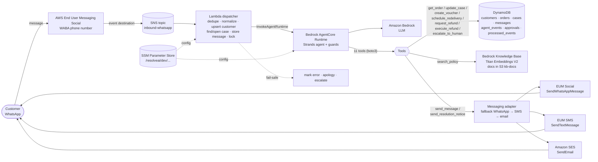
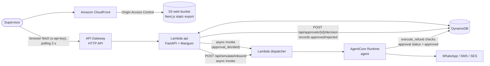
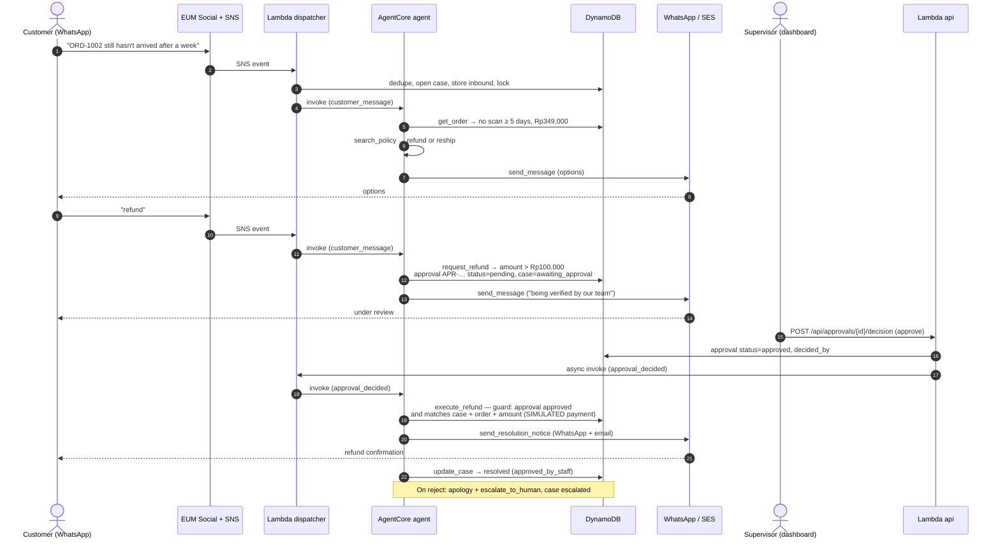

# ResolveAI Architecture

Single region (`us-east-1`), single environment (`dev`). All resources are named `resolveai-dev-*` and defined with AWS CDK (Python) in `infra/`, except the manual steps listed in the [README](../README.md#2-manual-aws-steps-not-automated-by-cdk) (model access, SES identity, WABA, SMS origination, Knowledge Base, SSM parameters, AgentCore deployment).

> Status: the architecture is implemented and tested offline; it has **not yet been deployed or verified on AWS**. See [`STATUS.md`](STATUS.md).

## 1. Inbound path (customer → agent → real messages)

Notes:
- Every tool call and result is written to `agent_events`, which drives the timeline in the dashboard.
- Tools never take a recipient: `send_message` and `send_resolution_notice` resolve the recipient from the case's customer.
- Payment (`execute_refund`) and courier (`schedule_redelivery`) only update DynamoDB and are labelled **simulated**; the outgoing messages are real.

## 2. Dashboard path (supervisor → API → approval → agent)

API routes (`backend/api/app.py`): `GET /api/health` (no key), `GET /api/cases`, `GET /api/cases/{case_id}`, `GET /api/approvals`, `POST /api/approvals/{approval_id}/decision`, `POST /api/simulate/inbound`, `GET /api/metrics`. `POST /api/demo/reset` is being added.

## 3. Scenario B: lost parcel, refund above the limit needs approval

## 4. Component → file map

| Component | AWS resource | Code in this repo |
|---|---|---|
| Data tables + buckets | DynamoDB (7 tables), S3 `kb-docs` | `infra/stacks/data_stack.py` |
| Inbound topic | SNS `inbound-whatsapp` | `infra/stacks/messaging_stack.py` |
| Knowledge Base | Bedrock KB (created manually), S3 data source | `infra/stacks/knowledge_stack.py`, `rag/policies/*.md`, `rag/eval/queries.yaml` |
| Dashboard hosting | S3 `web` + CloudFront (OAC) | `infra/stacks/web_stack.py`, `dashboard/` |
| Lambdas + API | Lambda `dispatcher`, Lambda `api`, API Gateway HTTP API, IAM | `infra/stacks/compute_stack.py`, `infra/app.py` |
| Dispatcher | Lambda `dispatcher` | `backend/dispatcher/handler.py`, `core.py`, `inbound.py` |
| API | Lambda `api` | `backend/api/app.py`, `schemas.py`, `metrics.py`, `handler.py` |
| Backend services | — | `backend/services/` (`agent_client.py`, `config.py`, `data.py`, `trigger.py`) |
| Agent entrypoint | AgentCore Runtime | `agent/app.py` (fallback Lambda: `agent/lambda_handler.py`) |
| Agent turn + model | Bedrock | `agent/runner.py`, `agent/agent_factory.py`, `agent/prompts/system_id.md` |
| Guards | — | `agent/guards.py`, `agent/tools/registry.py` |
| Tools (11) | DynamoDB, KB, messaging | `agent/tools/orders.py`, `policy_search.py`, `actions.py`, `case.py`, `messaging.py` |
| Shared library | — | `packages/common/src/resolveai_common/` (`models.py`, `repository.py`, `policy.py`, `phone.py`, `logging.py`) |
| Messaging adapters | EUM Social, EUM SMS, SES | `packages/common/src/resolveai_common/messaging/` (`whatsapp.py`, `sms.py`, `ses.py`, `dispatch.py`, `templates/`) |
| Configuration | SSM `/resolveai/dev/...` | `agent/config.py`, `backend/services/config.py` |
| Build / ops scripts | — | `scripts/build_lambda.sh`, `scripts/build_agent.sh`, `scripts/seed.py`, `scripts/send_test_message.py`, `scripts/dump_openapi.py`, `Makefile` |
