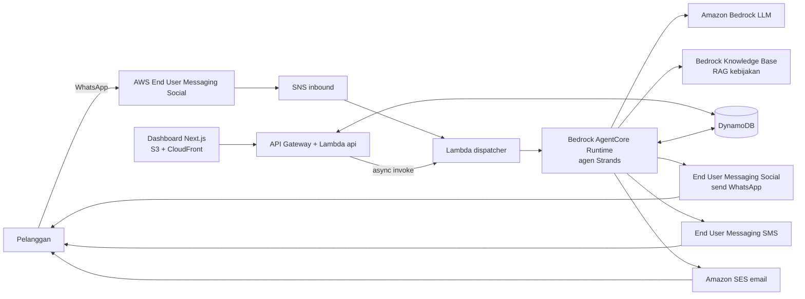

# PRD 00 — Overview: ResolveAI

Versi 1.0 · Status: siap dibangun · Builder: solo
Target submit internal: **Rabu 28 Okt 2026, 22.00 WITA** (deadline resmi menurut brief: 28 Okt 13.00 PT ≈ 29 Okt 04.00 WITA — verifikasi ke aturan resmi).

---

## 1. Ringkasan produk

ResolveAI adalah agen AI (agentic) yang menangani keluhan pelanggan e-commerce/logistik **dari awal sampai selesai** lewat WhatsApp, SMS, dan email: memahami keluhan → menyelidiki data pesanan → memeriksa kebijakan (RAG) → memilih dan menjalankan tindakan → meminta persetujuan staf untuk tindakan sensitif → mengirim konfirmasi lewat kanal yang sesuai → mencatat semuanya di dashboard.

Bukan chatbot tanya-jawab. Nilai jual: agen **mengambil tindakan** (voucher, jadwal ulang, refund, eskalasi) dengan guardrail dan human-in-the-loop.

## 2. Masalah & nilai

Tim CS menghabiskan banyak waktu pada tiket berulang: "pesanan saya di mana", keterlambatan, paket hilang. ResolveAI menyelesaikan kasus rutin otomatis dan hanya melibatkan staf untuk keputusan berisiko, sehingga waktu respons turun dan staf fokus pada kasus kompleks.

## 3. Tujuan dan non-tujuan

**Tujuan MVP**
- G1. Tiga skenario demo (§7) selesai end-to-end tanpa campur tangan developer.
- G2. Pesan **nyata** terkirim lewat AWS SDK di runtime (email wajib; WhatsApp dan/atau SMS sesuai ketersediaan).
- G3. Dashboard menampilkan kasus, linimasa langkah agen, antrean approval, dan metrik.
- G4. Aksi sensitif tidak pernah berjalan tanpa approval (dibuktikan test).

**Non-tujuan**
Melatih model, auth multi-user, multi-tenant, integrasi payment gateway/kurir sungguhan (disimulasikan dan disebut jujur), parsing email masuk, voice, bahasa selain ID/EN, aplikasi mobile.

## 4. Metrik sukses (demo)

| Metrik | Target |
|---|---|
| Skenario A, B, C selesai e2e | 3/3, berulang ≥3 kali tanpa gagal |
| Waktu balasan pertama (inbound → outbound pertama) | p90 ≤ 20 detik |
| Pesan nyata terkirim per kanal yang dipakai | ≥1 dengan bukti (log + screenshot) |
| Pembaruan dashboard setelah perubahan | ≤ 5 detik |
| Aksi sensitif tanpa approval | 0 (assert di test) |

## 5. Pemetaan kriteria hackathon

Berdasarkan brief: Technical Execution 40%, Potential Value/Impact 20%, Demo Presentation 20% (sisanya: cek aturan resmi).

| Kriteria | Bukti dalam produk |
|---|---|
| Technical Execution | Bedrock (LLM), **AgentCore Runtime** (agen), Bedrock Knowledge Base (RAG), End User Messaging Social + SMS + SES (pesan nyata), DynamoDB, Lambda, API Gateway, CDK, test otomatis, observability |
| Value / Impact | Metrik di dashboard (auto-resolution rate, waktu respons, eskalasi), narasi penghematan beban CS, rute produk: e-commerce, logistik, telko |
| Demo | Skrip 3 menit di `07-testing-demo.md`: keluhan nyata masuk → tindakan nyata → pesan nyata diterima |
| Persyaratan eksplisit | SDK AWS dipakai untuk kirim pesan sungguhan (lihat `05-messaging.md`), bukan sekadar disebut di README |

## 6. Persona

- **Rani (pelanggan)** — pembeli online, memakai WhatsApp, ingin kepastian cepat.
- **Dimas (supervisor CS)** — memantau dashboard, menyetujui/menolak refund, menangani eskalasi.
- **Juri** — menilai lewat demo + repo; perlu melihat alur dan bukti dalam hitungan menit.

## 7. Skenario demo

Customer demo = nomor WhatsApp/email milik developer (dari env `DEMO_PHONE_E164`, `DEMO_EMAIL`).

**A — Terlambat 2 hari (auto-resolve, 2 giliran)**
1. Rani: "Pesanan ORD-1001 saya terlambat 2 hari."
2. Agen: `get_order` (ETA lewat 2 hari) → `search_policy` (delay ≥2 hari) → menawarkan 3 opsi: (1) jadwal ulang prioritas, (2) voucher Rp25.000, (3) bicara dengan staf.
3. Rani: "1" → agen `schedule_redelivery` → `send_resolution_notice` (WhatsApp + email) → kasus `resolved` (`auto_resolved`).

**B — Paket hilang, refund butuh approval (human-in-the-loop)**
1. Rani: "ORD-1002 belum sampai juga, sudah seminggu."
2. Agen: `get_order` (tanpa pembaruan tracking ≥5 hari, Rp349.000) → kebijakan: refund penuh atau kirim ulang → Rani memilih refund.
3. `request_refund` → karena >Rp100.000, status `pending_approval`; Rani diberi tahu "sedang diverifikasi tim"; kasus `awaiting_approval`.
4. Dimas menekan **Approve** di dashboard → agen dipanggil ulang (`approval_decided`) → `execute_refund` (disimulasikan) → konfirmasi WhatsApp + email → `resolved` (`approved_by_staff`).
5. Varian reject: agen minta maaf, `escalate_to_human`.

**C — Eskalasi aman**
1. Rani: "ORD-1003 katanya sudah diterima tapi saya tidak terima apa-apa. Saya akan lapor polisi!"
2. Agen mengenali klaim "delivered tapi tidak diterima" + ancaman hukum → `escalate_to_human(priority=high)` → pelanggan diberi tahu staf akan menghubungi (jam operasional 08.00–20.00 WIB) → kasus `escalated`.

## 8. Arsitektur



**Alur**
1. Pesan masuk (WhatsApp → SNS → `dispatcher`, atau Simulator di dashboard → `api` → async `dispatcher`).
2. `dispatcher`: dedupe, normalisasi, upsert pelanggan, cari/buka kasus, simpan pesan, pasang lock, panggil AgentCore Runtime.
3. Agen: memakai tools (order, kebijakan RAG, aksi, pesan) dan mencatat setiap langkah ke `agent_events`.
4. Tool `send_message` / `send_resolution_notice` mengirim pesan nyata via adapter kanal.
5. Aksi sensitif → `approvals` berstatus `pending` → staf memutuskan di dashboard → `api` mencatat keputusan → async `dispatcher` memanggil agen dengan event `approval_decided`.
6. Dashboard membaca `api` (polling 3 detik).

## 9. Keputusan teknis (ADR ringkas)

| Keputusan | Alasan | Fallback |
|---|---|---|
| Region tunggal `us-east-1` | Ketersediaan Bedrock/AgentCore/Social Messaging paling luas | Region lain jika layanan tak tersedia; verifikasi di M0 |
| Agen: Strands Agents di AgentCore Runtime | Cepat, tool via decorator, native Bedrock | Jalankan kode agen yang sama di Lambda bila deploy AgentCore tertahan >60 menit |
| Tool berisi side effect di dalam container agen (boto3 langsung) | Paling sedikit komponen untuk solo build | AgentCore Gateway (P2) |
| DynamoDB multi-tabel | Lebih mudah dipahami dan dites daripada single-table | — |
| Dashboard static export di S3 + CloudFront | Sederhana, murah | Amplify Hosting |
| Polling 3 detik, bukan WebSocket | Cukup untuk demo | SSE (P2) |
| Approval via dashboard (utama), balasan "YA" pelanggan untuk pilihan opsi | Demo jelas dan terkontrol | — |
| Pembayaran/kurir disimulasikan | Di luar cakupan; pesan tetap nyata | — |

## 10. Data model bersama (kontrak lintas platform)

Semua platform mengikuti skema ini. Implementasi pydantic ada di `packages/common/models.py`.

**customers** — PK `customer_id`. Atribut: `name`, `phone_e164`, `email`, `language` (`id|en`), `preferred_channel` (`whatsapp|sms|email`), `created_at`. GSI `by_phone` (PK `phone_e164`).

**orders** — PK `order_id`. Atribut: `customer_id`, `status` (`processing|shipped|in_transit|out_for_delivery|delivered|cancelled|refunded`), `items[{name,qty,price_idr}]`, `total_idr`, `courier`, `tracking_number`, `shipped_at`, `eta`, `last_scan_at`, `last_scan_location`, `tracking_events[{ts,location,desc}]`, `redelivery_at?`, `refund?{status,amount_idr,at}`, `created_at`. GSI `by_customer` (PK `customer_id`, SK `created_at`).
Nilai turunan dihitung saat `get_order`: `days_late` (dari `eta`), `days_since_last_scan`, `eligibility` (lihat `03-agent.md`).

**cases** — PK `case_id`. Atribut: `customer_id`, `order_id?`, `channel` (kanal inbound pertama), `status` (`open|investigating|awaiting_customer|awaiting_approval|escalated|resolved|error`), `category` (`late_delivery|lost_package|not_received|status_inquiry|address_change|other`), `priority` (`normal|high`), `resolution_type?` (`auto_resolved|approved_by_staff|rejected_by_staff|escalated`), `resolution?{action,amount_idr,voucher_code,summary}`, `summary`, `first_inbound_at`, `first_response_at`, `resolved_at`, `created_at`, `updated_at`, `lock_until?`, `seeded` (bool). GSI `by_customer` (PK `customer_id`, SK `updated_at`), `by_status` (PK `status`, SK `updated_at`).

**messages** — PK `case_id`, SK `ts#msg_id`. Atribut: `direction` (`inbound|outbound`), `author` (`customer|agent|staff|system`), `channel` (`whatsapp|sms|email`), `body`, `provider_message_id?`, `delivery_status` (`queued|sent|delivered|read|failed`), `error?`, `simulated` (bool), `created_at`. GSI `by_provider_id` (P1).

**agent_events** — PK `case_id`, SK `ts#seq`. Atribut: `type` (`tool_call|tool_result|model_message|escalation|error`), `tool?`, `input?`, `output?` (dipotong 4 KB), `latency_ms?`, `ok`.

**approvals** — PK `approval_id`. Atribut: `case_id`, `order_id`, `action` (`refund`), `amount_idr`, `reason`, `status` (`pending|approved|rejected`), `requested_at`, `decided_at?`, `decided_by?`, `note?`. GSI `by_status` (PK `status`, SK `requested_at`).

**processed_events** — PK `event_id`, `ttl` (idempotensi inbound).

**Konstanta kebijakan** (`packages/common/policy.py`, satu sumber kebenaran untuk kode; dokumen RAG mencerminkannya):

| Konstanta | Nilai |
|---|---|
| `DELAY_APOLOGY_DAYS` | 1 |
| `DELAY_COMPENSATION_DAYS` | 2 |
| `LOST_THRESHOLD_DAYS` (tanpa pembaruan tracking) | 5 |
| `VOUCHER_MAX_IDR` | 25000 |
| `AUTO_REFUND_LIMIT_IDR` | 100000 |
| `MAX_TOOL_CALLS_PER_TURN` | 8 |
| `MAX_OUTBOUND_PER_TURN` | 5 |
| `CASE_REUSE_WINDOW_HOURS` | 24 |
| `STAFF_HOURS` | 08.00–20.00 WIB |

## 11. Struktur repo

```
resolveai/
├─ CLAUDE.md
├─ Makefile
├─ docs/
│  ├─ prd/ (dokumen ini)
│  ├─ STATUS.md
│  └─ evidence/            # screenshot + ID pesan nyata
├─ packages/common/        # models, repo DynamoDB, policy, phone, logging, messaging adapters
├─ infra/                  # AWS CDK (Python)
├─ backend/                # Lambda dispatcher + api (FastAPI/Mangum)
├─ agent/                  # AgentCore Runtime (Strands) + tools + prompts
├─ rag/                    # policies/*.md, ingest script, eval set
├─ dashboard/              # Next.js
├─ scripts/                # seed, simulate, send_test_message, eval_agent
└─ tests/                  # unit, integration, e2e
```
Kode `packages/common` dipakai backend dan agen. Untuk build agen, script `scripts/build_agent.sh` menyalin `packages/common` ke `agent/_vendor/` sebelum deploy.

## 12. Milestone dan urutan kerja

| ID | Nama | Perkiraan | Isi | Exit criteria |
|---|---|---|---|---|
| M0 | Fondasi & akses | 2 jam | Repo, Makefile, akses Bedrock, SES identity, mulai daftar WABA, SMS sandbox, CDK bootstrap, DataStack, seed | `make deploy` membuat tabel; `make seed` terisi; satu panggilan Bedrock berhasil; verifikasi email SES selesai |
| M1 | Messaging nyata | 3 jam | Adapter SES/WhatsApp/SMS + `send_test_message.py` | Pesan nyata dari CLI diterima di ponsel/email developer |
| M2 | RAG | 2 jam | Dokumen kebijakan, Knowledge Base, `search_policy` | 12 pertanyaan eval mengembalikan sumber benar |
| M3 | Agent | 5 jam | Tools, prompt, guard, run lokal skenario A/B/C, deploy AgentCore | A/B/C lolos lewat `scripts/eval_agent.py`; agen ter-deploy dan bisa di-invoke |
| M4 | Backend & orkestrasi | 4 jam | Dispatcher, API, approval, inbound SNS, simulate | A/B/C jalan e2e di AWS via Simulator |
| M5 | Dashboard | 5 jam | Semua halaman di `06-dashboard.md` | Demo berjalan penuh dari dashboard |
| M6 | Hardening & submission | 6 jam | Test e2e, smoke test kanal nyata, video, README, submit | Checklist submit di `07` tercentang |

Paralelisme: M1, M2, M3 bisa berjalan paralel setelah M0. Dashboard (M5) boleh mulai setelah kontrak API di `02-backend.md` §5 dibekukan; gunakan git worktree terpisah. Generate tipe TypeScript dari OpenAPI (`openapi-typescript`).

## 13. Kebutuhan non-fungsional

- Latensi: balasan pertama p90 ≤ 20 s; dashboard refresh ≤ 5 s.
- Keandalan: pengiriman pesan punya fallback kanal; kegagalan agen → jalur aman (`02-backend.md` §7).
- Keamanan: IAM least privilege, secret di SSM, bucket privat, tanpa PII di log, input pelanggan diperlakukan tak tepercaya (prompt injection).
- Biaya: pasang AWS Budget; hapus OpenSearch Serverless (jika dipakai) setelah hackathon.
- Observability: log JSON ber-`case_id`, AgentCore Observability aktif, `agent_events` untuk linimasa.

## 14. Risiko dan mitigasi

| Risiko | Dampak | Mitigasi |
|---|---|---|
| Verifikasi WABA/Meta lambat | Tidak ada WhatsApp nyata | Mulai daftar di M0; fallback demo SMS + email; inbound lewat Simulator |
| SMS Indonesia butuh registrasi sender ID | SMS tak terkirim | Verifikasi nomor tujuan di sandbox; cek aturan negara di console; jadikan SMS fallback saja |
| SES sandbox | Email hanya ke alamat terverifikasi | Verifikasi email demo di M0 |
| Deploy AgentCore tersendat | M3/M4 terblokir | Fallback agen di Lambda (kode sama) |
| LLM tidak deterministik | Demo gagal | Guard di tool, template deterministik untuk notifikasi akhir, eval berulang, rekaman cadangan |
| Skema payload inbound WhatsApp berbeda dari asumsi | Parser gagal | Log event mentah dulu, tulis parser dari fixture nyata |
| Syarat APN/ACE Opportunity ID tidak terpenuhi | Tidak bisa submit | Cek §16 sekarang, sebelum membangun |

## 15. Konfigurasi (env / SSM)

Prefix SSM: `/resolveai/dev/`. Daftar lengkap ada di `01-infrastructure.md` §5. Variabel utama: `AWS_REGION`, `BEDROCK_MODEL_ID`, `KB_ID`, `WA_PHONE_NUMBER_ID`, `SMS_ORIGINATION_IDENTITY`, `SES_FROM_EMAIL`, `AGENT_RUNTIME_ARN`, `API_KEY`, `DEMO_PHONE_E164`, `DEMO_EMAIL`.

## 16. Pra-syarat non-teknis (cek sebelum membangun)

- [ ] Organisasi APN yang memenuhi syarat dan **AWS ACE Opportunity ID** tersedia.
- [ ] Aturan resmi dibaca ulang: tenggat, format submit, kewajiban video/repo, bahasa submission.
- [ ] Akun AWS dengan akses Bedrock model, AgentCore, End User Messaging, SES, kuota cukup.
- [ ] Nomor WhatsApp khusus untuk WABA (tidak sedang dipakai di aplikasi WhatsApp biasa) dan akun Meta Business.

## 17. Glosarium

**WISMO** "where is my order". **WABA** WhatsApp Business Account. **HITL** human-in-the-loop. **KB** Knowledge Base. **EUM** AWS End User Messaging.

## 18. Peta dokumen

`01-infrastructure` · `02-backend` · `03-agent` · `04-rag` · `05-messaging` · `06-dashboard` · `07-testing-demo`
